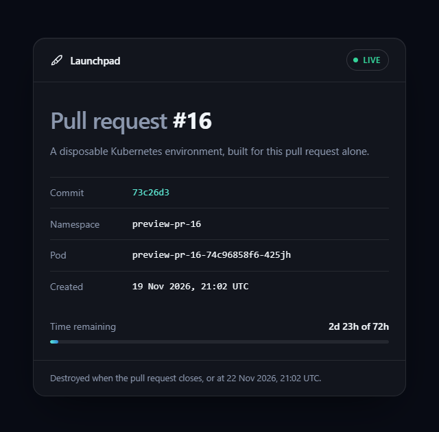
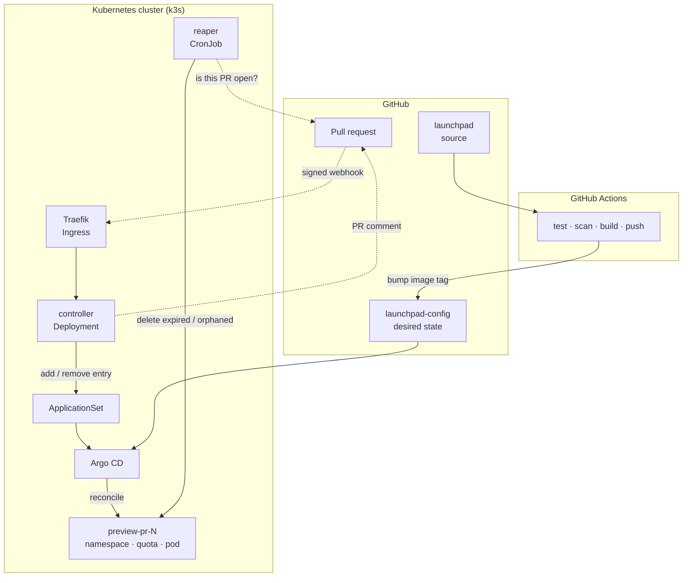
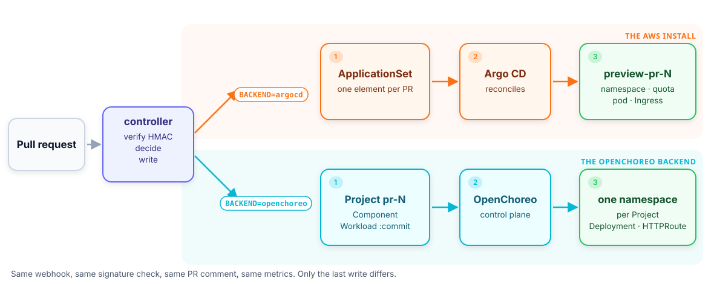
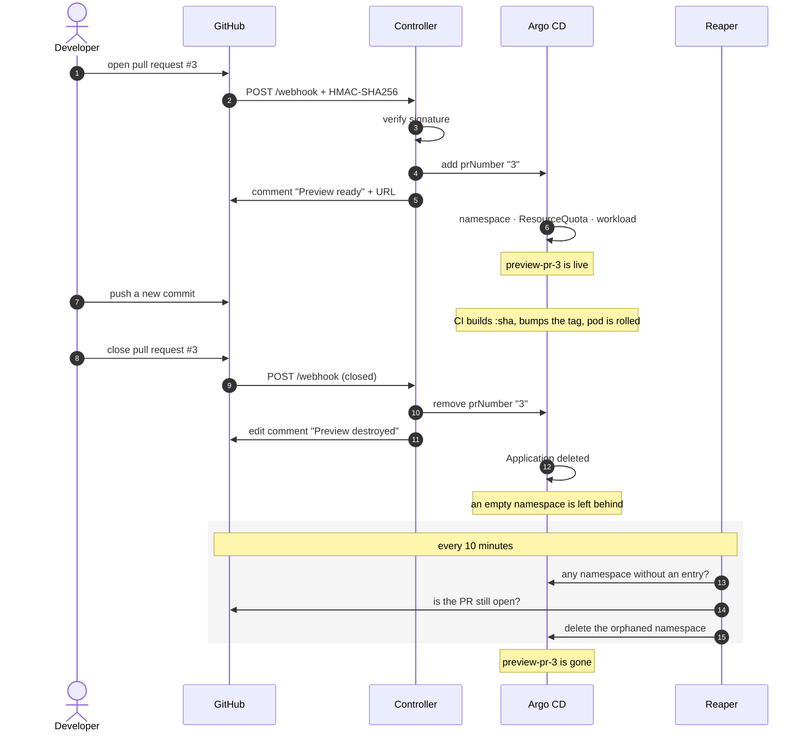
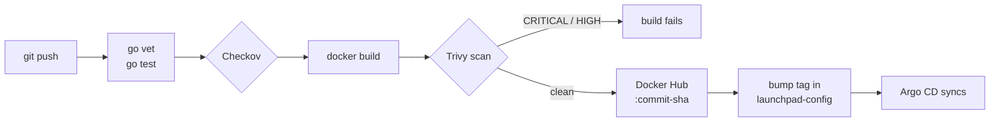
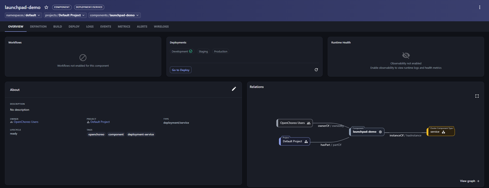
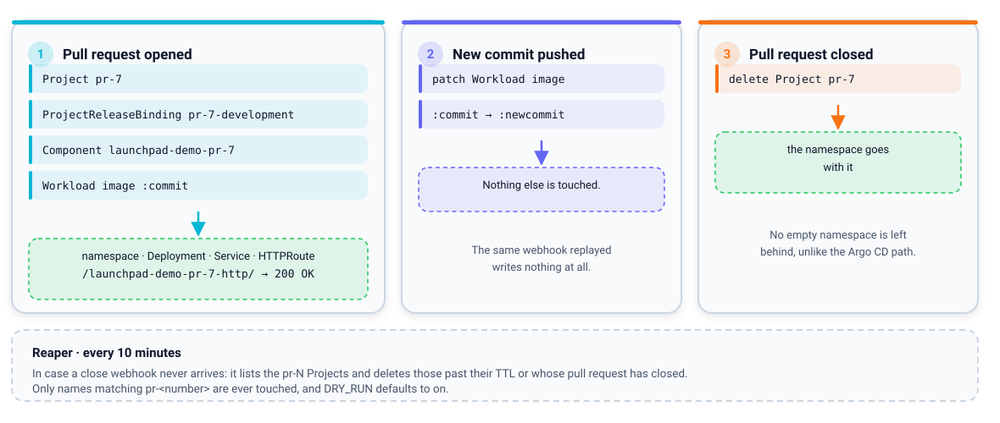

# Launchpad

**Every pull request gets its own live environment.**

Open a PR and a preview environment appears on Kubernetes: its own namespace, its
own quota, its own pod, its own URL. The bot posts the link on the PR. Push again and
it rolls forward. Close the PR and everything it created goes away.

This is the Kubernetes equivalent of Vercel preview deployments and Heroku Review
Apps. It exists because reviewing a diff is guesswork; clicking the thing is not.

One controller, two platforms underneath it: **Argo CD**, which is what runs on AWS, or
**[OpenChoreo](#running-on-openchoreo)**, where every pull request becomes its own
OpenChoreo Project.

---

## The problem

A reviewer who wants to actually run a branch has to pull it, install dependencies,
run migrations, resolve a port conflict, and lose half an hour. Most don't. They read
the diff, write "LGTM", and merge.

Launchpad removes that cost.


*Everything in this diagram is implemented and was verified end to end on AWS, from a
single `terraform apply`.*

---

## What it looks like

The bot comment on a pull request:


The preview itself, served at `http://pr-N.<ip>.nip.io`:



The Grafana dashboard fed by the controller's metrics:


---

## Architecture

Two loops meet at one ApplicationSet. The delivery loop moves code into the cluster;
the lifecycle loop decides which environments still deserve to exist.



Nothing here runs `kubectl apply`. The controller writes to the ApplicationSet;
Argo CD reconciles the cluster against it. The controller itself is deployed the
same way, so it is managed by the system it drives.

### Two backends, one controller

What the diagram calls the ApplicationSet is one of two ways an environment can be created.
`BACKEND` decides which:

<picture>
  <source media="(prefers-color-scheme: dark)" srcset="docs/backends-dark.svg">
  
</picture>

The webhook, the signature check, the idempotency, the PR comment and the metrics are the
same on both paths; only the objects written at the end differ. Argo CD is the default and
the one running on AWS. The other path is [Running on OpenChoreo](#running-on-openchoreo).

---

## Lifecycle of one pull request



---

## Delivery pipeline



The only manual step is the first `git push`.

---

## Components

### `cmd/controller` — webhook receiver

Long-running Deployment, reached through a Traefik Ingress at `/webhook`. Verifies
the GitHub HMAC-SHA256 signature on every request, then adds or removes a PR entry
in the Argo CD ApplicationSet through `client-go`, and posts (or edits) one comment
on the pull request with the preview URL. With `BACKEND=openchoreo` it writes OpenChoreo
objects at that last step instead, and nothing else about it changes.

- Signature comparison is constant-time (`hmac.Equal`), so timing does not leak it
- Request bodies are capped at 1 MiB
- Adding a preview is idempotent — GitHub replays webhooks
- ApplicationSet read-modify-write is serialised with a mutex, so two webhooks
  arriving together cannot overwrite each other
- The comment carries a hidden marker, so the bot edits its own comment instead of
  spamming a new one
- A failed comment never fails the webhook; it only increments a metric
- Preview host is `pr-N.<ip-with-dashes>.nip.io`, so no DNS setup is needed
- One binary, two backends: `BACKEND` selects Argo CD (the default) or OpenChoreo

### `cmd/reaper` — environment reclamation

CronJob, every 10 minutes. For each `preview-pr-N` namespace it asks whether the
environment should still exist, and destroys it when any of these hold:

| Condition | Why it matters |
|---|---|
| No ApplicationSet entry | Argo CD does not remove namespaces it created via `CreateNamespace=true`, so they outlive their Application. Confirmed on AWS |
| Older than TTL (default 72h) | Someone opens a PR and goes on leave |
| Pull request is closed | The obvious case, and the one that is easiest to miss |

The binary defaults to `DRY_RUN=true`. A job that deletes namespaces should not
delete anything the first time it runs somewhere new; the Helm chart turns it off
explicitly. A GitHub API failure is never treated as evidence that a PR is closed.

With `BACKEND=openchoreo` it sweeps the `pr-N` Projects rather than the namespaces. The TTL
and closed-pull-request rules are the same two; the orphan rule has nothing to say there,
because the Project *is* the record of the preview.

### `launchpad-config` — the GitOps repository

Helm charts, ApplicationSet definitions, monitoring, Kyverno policies, per-environment
values. The single source of truth for cluster state.
[SihanUdayaratna03/launchpad-config](https://github.com/SihanUdayaratna03/launchpad-config)

---

## Isolation and security

Every preview is a separate namespace with the same guard rails, applied
automatically:

| Layer | What it does |
|---|---|
| `ResourceQuota` | Caps pods, CPU and memory per preview, so one PR cannot starve the node |
| `NetworkPolicy` | Default-deny between namespaces |
| Kyverno | Admission policies on preview namespaces: allowed registries only, no `:latest`, no privileged containers, non-root only, requests and limits required |
| RBAC | Controller and reaper have separate ServiceAccounts with only the verbs they need |
| Webhook | HMAC-SHA256, constant-time compare, 1 MiB body limit |
| Supply chain | Trivy scans the image and Checkov scans the infrastructure code; both run in CI |
| Host | IMDSv2 required, encrypted gp3 volume, SSH and the Kubernetes API open only to one CIDR |

---

## Running on OpenChoreo

[OpenChoreo](https://openchoreo.dev) is the open-source internal developer platform from
Choreo Labs (formerly WSO2), a CNCF Sandbox project. I ran it on my own laptop, deployed this
project's demo workload on it as a Component, and then taught Launchpad's controller to use
OpenChoreo as its deployment engine: with `BACKEND=openchoreo`, a pull request gets an
OpenChoreo Project instead of an Argo CD Application.


*The Launchpad demo, deployed by OpenChoreo and served through its gateway. The page still
says "PR #?" and "unknown" because it reads the PR number and namespace from environment
variables that Launchpad's chart sets and my OpenChoreo Workload does not. The "destroyed
when the pull request closes" footer is the demo's own text; nothing here is tied to a pull
request.*



### What I did

1. **Installed OpenChoreo v1.3.3** on a local k3d cluster: control plane and data plane,
   following the official guide step by step (Gateway API, cert-manager, External Secrets,
   kgateway, OpenBao, ThunderID, then the planes). The console shows the data plane as
   *Connected*.
2. **Deployed the demo image** with one `kubectl apply` of two objects, a `Component` and a
   `Workload` ([`deploy/openchoreo/launchpad-demo.yaml`](deploy/openchoreo/launchpad-demo.yaml)).
3. **Checked what OpenChoreo built from them**: a Deployment (1/1 available), a Service on
   8080 and a Gateway API `HTTPRoute`, all in a namespace it created for the
   `development` environment. `curl` on the route returns `200 OK`.
4. **Made Launchpad deploy through it**: a second backend in the controller, one OpenChoreo
   Project per pull request, described under
   [Launchpad on OpenChoreo](#launchpad-on-openchoreo) below.

The install and the first deployment, with every command and the version of every tool, are in
[`docs/openchoreo.md`](docs/openchoreo.md).

### How the two models compare

Launchpad's own model, against OpenChoreo's as it ships:

| | Launchpad | OpenChoreo |
|---|---|---|
| What describes a deployment | One ApplicationSet element (`prNumber`, image tag) | A `Component` and a `Workload` |
| Template that renders it | `charts/preview` (Deployment, Service, Ingress, quota, NetworkPolicy) | `ClusterComponentType` `deployment/service` |
| Unit of environment | One namespace per pull request, `preview-pr-N` | Fixed `Environment`s (development, staging, production) with a `DeploymentPipeline` |
| Where workloads run | The same cluster | A data plane registered with the control plane |
| Routing | Traefik Ingress, `pr-N.<ip>.nip.io` | Gateway API `HTTPRoute`, host `development-default.openchoreoapis.localhost`, path `/<component>-http` |
| Lifecycle | Created on PR open, destroyed on close, TTL reaper | A long-lived Component promoted through environments |

### What I took from it

- **Different units.** Launchpad's unit is a short-lived environment per pull request.
  OpenChoreo's is a long-lived component moved through a fixed set of environments. They
  answer different questions, which is what made the backend below worth writing.
- **Isolation follows the Project, not the Component.** The namespace OpenChoreo creates
  (`dp-default-default-development-...`) is named after the namespace, project and
  environment, so several components in one project share a namespace. Per-pull-request
  isolation therefore needs a *Project* per pull request. That is what the backend below
  does, and deleting the Project takes the namespace with it.
- **OpenChoreo gives more out of the box**: a console, a catalog, ownership, a project
  model, and an install that wires up a gateway, certificates and a secret store. Launchpad
  is smaller and more explicit about every moving part.
- **A gap Launchpad fills.** OpenChoreo has an open issue about ephemeral environments
  per branch or pull request
  ([openchoreo#4345](https://github.com/openchoreo/openchoreo/issues/4345)). The backend
  below is one answer to it, built on OpenChoreo's own objects rather than around them.
- **Not covered here.** I did not test promotion between environments, or the build and
  observability planes (both optional and not installed). I make no claim about them.

### Launchpad on OpenChoreo

With `BACKEND=openchoreo` the controller stops editing the ApplicationSet. For each pull
request it asks OpenChoreo for a Project, which owns its own namespace on the data plane:

| PR event | What the controller does |
|---|---|
| opened / reopened | Creates `Project pr-N`, `ProjectReleaseBinding pr-N-development`, `Component launchpad-demo-pr-N`, and a `Workload` running `launchpad-demo:<commit>` |
| synchronize (new push) | Patches the Workload's image to the new commit. Nothing else changes |
| closed | Deletes the `Project`, and with it the preview's namespace |

Everything around that is shared with the Argo CD backend: the HMAC signature check, the single
edited PR comment, the Prometheus metrics, and idempotency, so a replayed webhook writes
nothing. Argo CD stays the default and the AWS install is untouched.

| Variable | Default | Meaning |
|---|---|---|
| `BACKEND` | `argocd` | `argocd` or `openchoreo` |
| `OC_NAMESPACE` | `default` | OpenChoreo namespace holding the objects |
| `OC_ENVIRONMENT` | `development` | Environment each preview is bound to |
| `OC_IMAGE` | `sihanudayaratna/launchpad-demo` | Image repository; the commit SHA is the tag |
| `OC_HOST` | `development-default.openchoreoapis.localhost:19080` | Gateway host and port |

The controller's permissions in this mode are a namespaced `Role`: `get`, `create`, `patch` and
`delete` on `projects`, `projectreleasebindings`, `components` and `workloads`. No `list`, no
`watch`, nothing cluster-wide, no access to secrets. The reaper, in this mode, needs `list`
and `delete` on `projects` and nothing else.

The TTL reaper has an `openchoreo` mode as well. Instead of walking the preview namespaces it
lists the `pr-N` Projects and deletes the ones past their TTL or whose pull request has
closed, which is what catches a preview whose close webhook never arrived. It only ever
touches names matching `pr-<number>`, so OpenChoreo's own Projects are left alone, and
`DRY_RUN` still defaults to on.

<picture>
  <source media="(prefers-color-scheme: dark)" srcset="docs/oc-lifecycle-dark.svg">
  
</picture>

#### What the end-to-end test proves

[`scripts/openchoreo-e2e.sh`](scripts/openchoreo-e2e.sh) builds the controller, runs it against a
local OpenChoreo cluster, and sends it signed pull-request webhooks the way GitHub would. All
thirteen checks pass:

```
== webhook security
  PASS: unsigned webhook rejected (401)
== PR #9001 opened
  PASS: opened accepted (202)
  PASS: Project pr-9001 created
  PASS: Workload runs the PR's commit
== waiting up to 180s for the preview URL
  PASS: http://development-default.openchoreoapis.localhost:19080/launchpad-demo-pr-9001-http/ answers 200
== replay
  PASS: replayed webhook accepted (202)
  PASS: replay changed nothing
== PR #9001 closed
  PASS: closed accepted (202)
  PASS: Project pr-9001 deleted
  PASS: data-plane namespace cleaned up
  PASS: closing again is harmless (202)
```

So the whole lifecycle holds up: a pull request becomes an isolated OpenChoreo Project that
serves HTTP, a second identical webhook changes nothing, and closing the pull request removes
the Project and the namespace underneath it.

#### Limits of this backend

- The Kyverno policies, `ResourceQuota` and `NetworkPolicy` come from Launchpad's own chart and
  are **not** applied in this mode. Isolation here is OpenChoreo's: one namespace per Project.
- Tested on a local k3d cluster, not on the AWS install.
- The PR comment carries the gateway URL. That body is unit-tested, but the end-to-end test runs
  without a GitHub token, so I have not watched a real comment appear in this mode.
- The reaper's OpenChoreo mode is unit-tested, but I have not yet run it on a schedule
  against a live cluster.
- The Component is the demo app. Other workloads mean parameterising the builders in
  `cmd/controller/openchoreo.go`.

---

## Monitoring

Prometheus and Grafana run in a `monitoring` namespace, deployed by Argo CD like
everything else. The controller exposes `/metrics` (not published through the
Ingress):

| Metric | Meaning |
|---|---|
| `launchpad_webhook_requests_total{result}` | Webhooks by outcome (the `result` label) |
| `launchpad_preview_events_total{action}` | Previews created and destroyed |
| `launchpad_comment_failures_total` | Failed PR comments |
| `launchpad_webhook_duration_seconds` | Time spent handling a webhook |

Six alert rules ship with it: controller down, webhook errors, webhook rejections,
comment failures, too many previews (more than 8) and a preview that is not ready.
A provisioned Grafana dashboard shows the same data.

Open Grafana:

```bash
kubectl -n monitoring port-forward svc/grafana 3000:80
kubectl -n monitoring get secret grafana -o jsonpath='{.data.admin-password}' | base64 -d
```

Then browse to `http://localhost:3000` and sign in as `admin`.

---

## Measured on AWS

One `c7i-flex.large` (2 vCPU, 4 GiB) in `ap-southeast-2`, Free Tier eligible:

| Measurement | Result |
|---|---|
| `terraform apply` to "bootstrap complete" | about 4 minutes |
| Webhook handling time | about 1.6 – 1.8 s |
| Node memory, platform only | 63% |
| Node memory, with monitoring | about 81% |
| Node memory, with monitoring and one preview | about 84% |
| Memory of one preview pod | about 2.5 MiB |

---

## Limits

Honest list of what this is not:

- **HTTP only.** Previews use `nip.io` and plain HTTP; there is no TLS or real domain
- **The IP changes on every `terraform apply`** (no Elastic IP, to stay inside the
  free tier), so the GitHub webhook Payload URL and `my_ip_cidr` must be updated
- **A closed PR's empty namespace can stay up to 10 minutes** until the reaper runs
- **First-image race.** A new commit's pod can show `ErrImagePull` until CI has
  pushed the `:sha` image; it recovers by itself on the next retry
- **Alerts are visible in the Prometheus UI only.** There is no Alertmanager
- **Secrets are created by hand** per cluster (`launchpad-webhook`, `launchpad-github`)
- **One node.** At about 84% memory it fits a handful of previews, not a team
- The "Preview destroyed" comment edit on PR close is covered by unit tests; I did
  not check it visually on AWS

---

## Design decisions

**Two repositories.**
Application source lives here; deployment state lives in `launchpad-config`. A code
commit is not a deployment. Keeping them apart means cluster history stays readable,
and CI never holds cluster credentials — Argo CD pulls, CI does not push.

**Immutable image tags.**
Workloads are pinned to a commit SHA, never `:latest`. A pod that restarts three
weeks later runs exactly the code that was deployed.

**Cleanup is a feature, not an afterthought.**
Creating environments is the easy half. Every environment carries a TTL, a
`ResourceQuota`, and an automatic reaper.

**Least privilege, split two ways.**
The controller can `get` and `patch` ApplicationSets — nothing else. The reaper has
a separate ServiceAccount that can `list` and `delete` namespaces but cannot add
entries. Neither can read secrets:

```console
$ kubectl auth can-i get secrets \
    --as=system:serviceaccount:argocd:launchpad-controller -n argocd
no

$ kubectl auth can-i patch applicationsets \
    --as=system:serviceaccount:argocd:launchpad-controller -n argocd
yes
```

**One image, two binaries.**
A multi-stage build produces `/controller` and `/reaper` into a distroless,
non-root base. Two images would mean two builds, two scans and two tags for one
codebase.

---

## Things that broke, and what they taught

**The quota holds.** Scaling a preview Deployment to 50 replicas stops at 10:

```console
$ kubectl scale deployment preview-pr-42 --replicas=50 -n preview-pr-42
$ kubectl describe resourcequota preview-quota -n preview-pr-42
Resource         Used    Hard
pods             10      10
limits.cpu       2       2

Error creating: pods "preview-pr-42-..." is forbidden:
exceeded quota: preview-quota, requested: pods=1, used: pods=10, limited: pods=10
```

**Trivy caught two HIGH CVEs on the first pipeline run** — `golang.org/x/net` and
`golang.org/x/text`, both reached through `client-go`, neither written by me. The
build stopped until they were patched. `go mod tidy` then pulled one of them back
down to the vulnerable version, which needed an explicit bump to hold.

**A 404 from GitHub means two different things.** The reaper read 404 as "this PR no
longer exists" and destroyed an environment whose pull request was open — the
repository was private and the call was unauthenticated. 404 is also what GitHub
returns for "you may not look at this". Dry-run mode exists for exactly this class
of mistake.

---

**Argo CD leaves the namespace behind.** After a PR closed, the Application
disappeared but `preview-pr-N` stayed, empty. With `CreateNamespace=true` Argo
creates the namespace but does not own it. This was found on AWS, not in theory, and
it is why the reaper has an "orphaned" rule instead of only a TTL.

**The first image does not exist yet.** A new PR creates the environment in seconds,
but CI needs longer to push `:sha`. The pod sits in `ErrImagePull` and the URL says
"no available server" until the image lands. Kubernetes retries, so it heals itself;
I documented it rather than hiding it.

**Prometheus 3 rejects a target with no `Content-Type`.** My local test used a
minimal stand-in server that sent none, so the target stayed down. Reproducing it
locally on k3d first, before spending AWS time, is how it was caught.

---

## Stack

| Layer | Tool |
|---|---|
| Orchestration | Kubernetes (kind locally, k3s on EC2) |
| GitOps | Argo CD + ApplicationSet |
| Platform (second backend) | OpenChoreo v1.3.3 |
| Ingress | Traefik |
| Packaging | Helm |
| Policy | Kyverno, NetworkPolicy, ResourceQuota |
| Containers | Docker, multi-stage, distroless, non-root |
| Registry | Docker Hub |
| CI | GitHub Actions, Trivy, Checkov |
| Infrastructure | Terraform |
| Observability | Prometheus + Grafana |
| Language | Go |
| AWS | EC2 + VPC |

---

## Repository layout

    cmd/
      controller/        webhook receiver, preview lifecycle on either backend,
                         PR comment, metrics
      reaper/            TTL, orphan and closed-PR reclamation, on either backend
    demo/                the trivial workload deployed into each preview
    terraform/           VPC, security groups, EC2, k3s + Argo CD bootstrap
    deploy/              bootstrap manifests, and the OpenChoreo Component and Workload
    scripts/             end-to-end check of the OpenChoreo backend
    docs/                diagrams, screenshots, the OpenChoreo install runbook
    .github/workflows/   test, scan, build, push, bump
    Dockerfile           multi-stage, both binaries

---

## Run it on AWS

Requires Terraform, an AWS account and the AWS CLI configured.

```bash
cd terraform
# create terraform.tfvars and set my_ip_cidr to your public IP, e.g. "203.0.113.7/32"
terraform init
terraform apply
```

The user-data script installs k3s and Argo CD and registers the root application, so
the rest of the platform comes up on its own. Then:

1. Fetch the kubeconfig and point it at the new public IP.
2. Create the two secrets in the `argocd` namespace:

   ```bash
   kubectl -n argocd create secret generic launchpad-webhook --from-literal=secret="<random hex>"
   kubectl -n argocd create secret generic launchpad-github  --from-literal=token="<fine-grained PAT>"
   ```

3. In the GitHub repository, add a webhook with Payload URL
   `http://<public_ip>/webhook`, content type `application/json`, the same secret,
   and the **Pull requests** event.
4. Open a pull request.

`terraform destroy` removes everything; nothing keeps billing.

---

## Local setup

Requires Docker, kind, kubectl and Helm.

```bash
kind create cluster --name launchpad

kubectl create namespace argocd
kubectl apply -n argocd -f \
  https://raw.githubusercontent.com/argoproj/argo-cd/stable/manifests/install.yaml
kubectl -n argocd rollout status deploy/argocd-server

kubectl create secret generic launchpad-webhook \
  -n argocd --from-literal=secret="<your webhook secret>"

kubectl -n argocd port-forward svc/argocd-server 8080:443
```

Point an Argo CD Application at `launchpad-config/charts/controller` and the rest
comes up on its own.

Sending a webhook by hand:

```bash
BODY='{"action":"opened","number":3,"pull_request":{"head":{"sha":"abc"}}}'
SIG=$(echo -n "$BODY" | openssl dgst -sha256 -hmac "<secret>" | awk '{print $2}')

curl -X POST localhost:8090/webhook \
  -H 'Content-Type: application/json' \
  -H "X-Hub-Signature-256: sha256=$SIG" \
  -d "$BODY"
```

Without the signature header the same request returns `401 Unauthorized`.

---

## Status

| Stage | |
|---|---|
| Local cluster, Argo CD, GitOps sync loop | Done |
| Helm chart with per-environment values | Done |
| ApplicationSet generator, ResourceQuota | Done |
| Controller: webhook, lifecycle, in-cluster RBAC | Done |
| Webhook HMAC signature verification | Done |
| PR comment bot (create, edit, preview URL) | Done |
| CI: test, Trivy, Checkov, build, push, tag bump | Done |
| Reaper: TTL, orphan and closed-PR cleanup | Done |
| NetworkPolicy, Kyverno policies | Done |
| Terraform + k3s on EC2, verified end to end | Done |
| Prometheus, Grafana, alert rules | Done |
| OpenChoreo backend: a Project per pull request, verified end to end | Done |
| Reaper sweeps OpenChoreo Projects | Done |
| OpenChoreo backend on the AWS install | Not done — local k3d only |
| TLS, Alertmanager, Elastic IP | Not planned (see Limits) |

---

## What this project is about

The workload deployed into a preview environment is deliberately trivial. It is a
prop. The work is everything around it: the reconciliation loop, the isolation
boundaries, the quota enforcement, the signature check, the teardown guarantees,
the infrastructure as code, the monitoring, and a pipeline that moves a commit from
a laptop into a cluster without anyone running a command.
