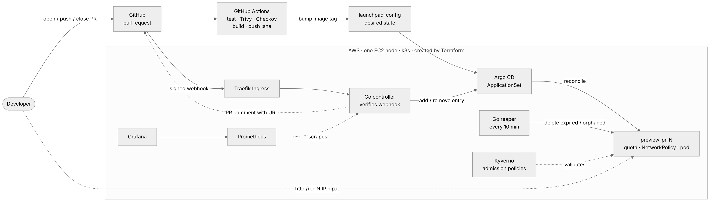
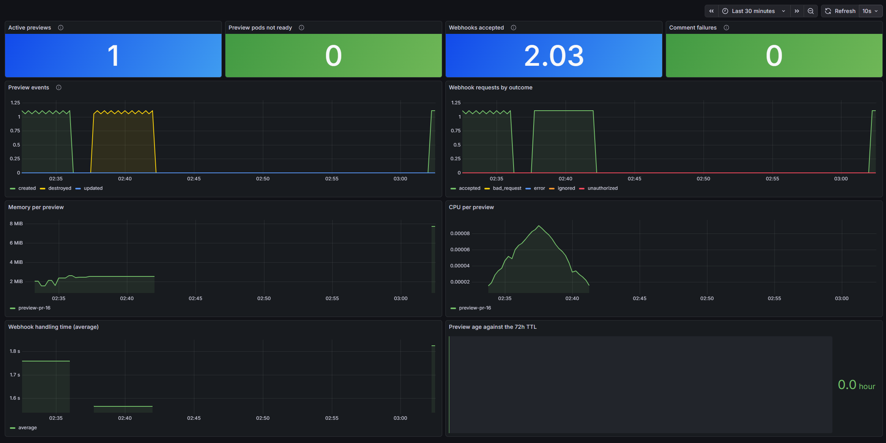
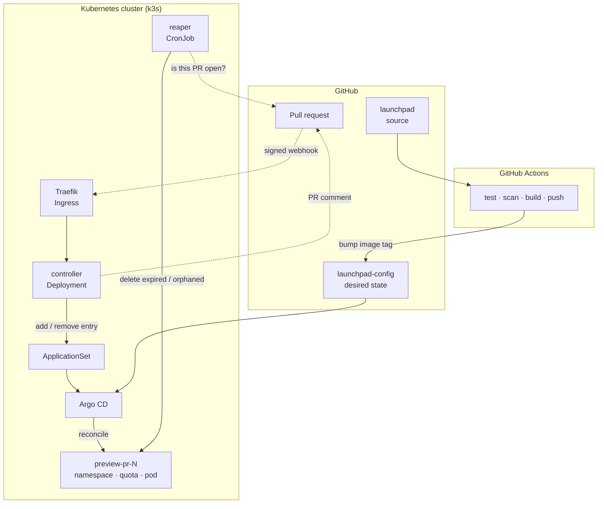
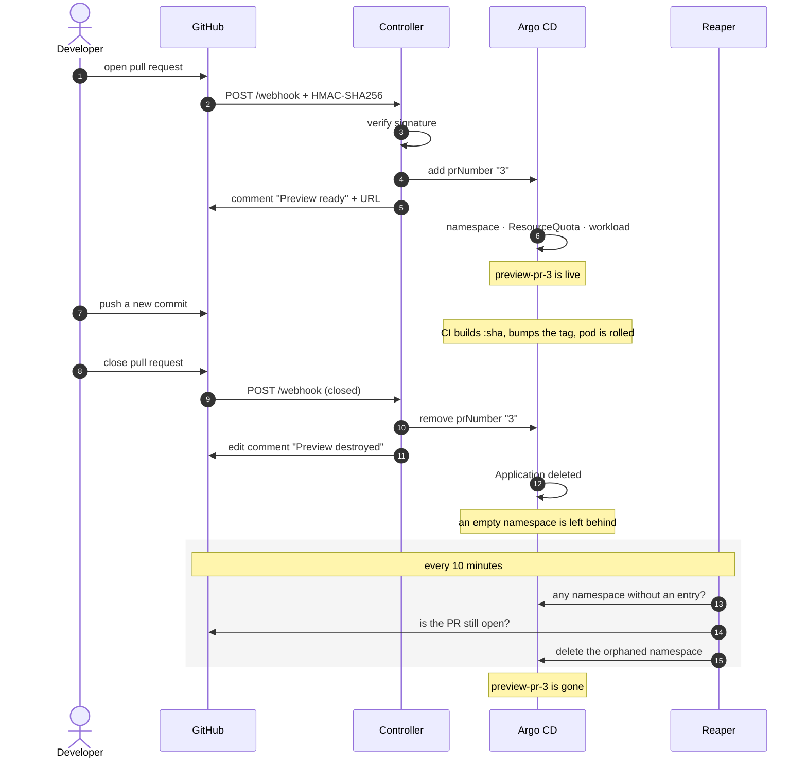
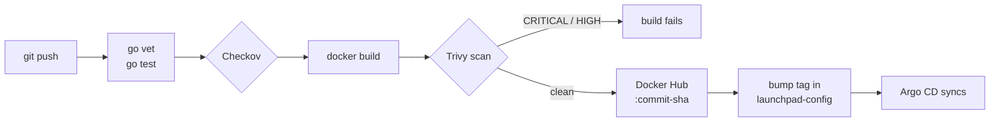

# Launchpad

**Every pull request gets its own live environment.**

Open a PR and a preview environment appears on Kubernetes: its own namespace, its
own quota, its own pod, its own URL. The bot posts the link on the PR. Push again and
it rolls forward. Close the PR and everything it created goes away.

This is the Kubernetes equivalent of Vercel preview deployments and Heroku Review
Apps. It exists because reviewing a diff is guesswork; clicking the thing is not.

---

## The problem

A reviewer who wants to actually run a branch has to pull it, install dependencies,
run migrations, resolve a port conflict, and lose half an hour. Most don't. They read
the diff, write "LGTM", and merge.

Launchpad removes that cost.



*Everything in this diagram is implemented and was verified end to end on AWS, from a
single `terraform apply`.*

---

## What it looks like

The bot comment on a pull request:


The preview itself, served at `http://pr-N.<ip>.nip.io`:


The Grafana dashboard fed by the controller's metrics:



---

## Architecture

Two loops meet at one ApplicationSet. The delivery loop moves code into the cluster;
the lifecycle loop decides which environments still deserve to exist.



Nothing here runs `kubectl apply`. The controller writes to the ApplicationSet;
Argo CD reconciles the cluster against it. The controller itself is deployed the
same way, so it is managed by the system it drives.

---

## Lifecycle of one pull request



---

## Delivery pipeline



The only manual step is the first `git push`.

---

## Components

### `cmd/controller` — webhook receiver

Long-running Deployment, reached through a Traefik Ingress at `/webhook`. Verifies
the GitHub HMAC-SHA256 signature on every request, then adds or removes a PR entry
in the Argo CD ApplicationSet through `client-go`, and posts (or edits) one comment
on the pull request with the preview URL.

- Signature comparison is constant-time (`hmac.Equal`), so timing does not leak it
- Request bodies are capped at 1 MiB
- Adding a preview is idempotent — GitHub replays webhooks
- ApplicationSet read-modify-write is serialised with a mutex, so two webhooks
  arriving together cannot overwrite each other
- The comment carries a hidden marker, so the bot edits its own comment instead of
  spamming a new one
- A failed comment never fails the webhook; it only increments a metric
- Preview host is `pr-N.<ip-with-dashes>.nip.io`, so no DNS setup is needed

### `cmd/reaper` — environment reclamation

CronJob, every 10 minutes. For each `preview-pr-N` namespace it asks whether the
environment should still exist, and destroys it when any of these hold:

| Condition | Why it matters |
|---|---|
| No ApplicationSet entry | Argo CD does not remove namespaces it created via `CreateNamespace=true`, so they outlive their Application. Confirmed on AWS |
| Older than TTL (default 72h) | Someone opens a PR and goes on leave |
| Pull request is closed | The obvious case, and the one that is easiest to miss |

The binary defaults to `DRY_RUN=true`. A job that deletes namespaces should not
delete anything the first time it runs somewhere new; the Helm chart turns it off
explicitly. A GitHub API failure is never treated as evidence that a PR is closed.

### `launchpad-config` — the GitOps repository

Helm charts, ApplicationSet definitions, monitoring, Kyverno policies, per-environment
values. The single source of truth for cluster state.
[SihanUdayaratna03/launchpad-config](https://github.com/SihanUdayaratna03/launchpad-config)

---

## Isolation and security

Every preview is a separate namespace with the same guard rails, applied
automatically:

| Layer | What it does |
|---|---|
| `ResourceQuota` | Caps pods, CPU and memory per preview, so one PR cannot starve the node |
| `NetworkPolicy` | Default-deny between namespaces |
| Kyverno | Admission policies on preview namespaces: allowed registries only, no `:latest`, no privileged containers, non-root only, requests and limits required |
| RBAC | Controller and reaper have separate ServiceAccounts with only the verbs they need |
| Webhook | HMAC-SHA256, constant-time compare, 1 MiB body limit |
| Supply chain | Trivy scans the image and Checkov scans the infrastructure code; both run in CI |
| Host | IMDSv2 required, encrypted gp3 volume, SSH and the Kubernetes API open only to one CIDR |

---

## Monitoring

Prometheus and Grafana run in a `monitoring` namespace, deployed by Argo CD like
everything else. The controller exposes `/metrics` (not published through the
Ingress):

| Metric | Meaning |
|---|---|
| `launchpad_webhook_requests_total{result}` | Webhooks by outcome (the `result` label) |
| `launchpad_preview_events_total{action}` | Previews created and destroyed |
| `launchpad_comment_failures_total` | Failed PR comments |
| `launchpad_webhook_duration_seconds` | Time spent handling a webhook |

Six alert rules ship with it: controller down, webhook errors, webhook rejections,
comment failures, too many previews (more than 8) and a preview that is not ready.
A provisioned Grafana dashboard shows the same data.

Open Grafana:

```bash
kubectl -n monitoring port-forward svc/grafana 3000:80
kubectl -n monitoring get secret grafana -o jsonpath='{.data.admin-password}' | base64 -d
```

Then browse to `http://localhost:3000` and sign in as `admin`.

---

## Measured on AWS

One `c7i-flex.large` (2 vCPU, 4 GiB) in `ap-southeast-2`, Free Tier eligible:

| Measurement | Result |
|---|---|
| `terraform apply` to "bootstrap complete" | about 4 minutes |
| Webhook handling time | about 1.6 – 1.8 s |
| Node memory, platform only | 63% |
| Node memory, with monitoring | about 81% |
| Node memory, with monitoring and one preview | about 84% |
| Memory of one preview pod | about 2.5 MiB |

---

## Limits

Honest list of what this is not:

- **HTTP only.** Previews use `nip.io` and plain HTTP; there is no TLS or real domain
- **The IP changes on every `terraform apply`** (no Elastic IP, to stay inside the
  free tier), so the GitHub webhook Payload URL and `my_ip_cidr` must be updated
- **A closed PR's empty namespace can stay up to 10 minutes** until the reaper runs
- **First-image race.** A new commit's pod can show `ErrImagePull` until CI has
  pushed the `:sha` image; it recovers by itself on the next retry
- **Alerts are visible in the Prometheus UI only.** There is no Alertmanager
- **Secrets are created by hand** per cluster (`launchpad-webhook`, `launchpad-github`)
- **One node.** At about 84% memory it fits a handful of previews, not a team
- The "Preview destroyed" comment edit on PR close is covered by unit tests; I did
  not check it visually on AWS

---

## Design decisions

**Two repositories.**
Application source lives here; deployment state lives in `launchpad-config`. A code
commit is not a deployment. Keeping them apart means cluster history stays readable,
and CI never holds cluster credentials — Argo CD pulls, CI does not push.

**Immutable image tags.**
Workloads are pinned to a commit SHA, never `:latest`. A pod that restarts three
weeks later runs exactly the code that was deployed.

**Cleanup is a feature, not an afterthought.**
Creating environments is the easy half. Every environment carries a TTL, a
`ResourceQuota`, and an automatic reaper.

**Least privilege, split two ways.**
The controller can `get` and `patch` ApplicationSets — nothing else. The reaper has
a separate ServiceAccount that can `list` and `delete` namespaces but cannot add
entries. Neither can read secrets:

```console
$ kubectl auth can-i get secrets \
    --as=system:serviceaccount:argocd:launchpad-controller -n argocd
no

$ kubectl auth can-i patch applicationsets \
    --as=system:serviceaccount:argocd:launchpad-controller -n argocd
yes
```

**One image, two binaries.**
A multi-stage build produces `/controller` and `/reaper` into a distroless,
non-root base. Two images would mean two builds, two scans and two tags for one
codebase.

---

## Things that broke, and what they taught

**The quota holds.** Scaling a preview Deployment to 50 replicas stops at 10:

```console
$ kubectl scale deployment preview-pr-42 --replicas=50 -n preview-pr-42
$ kubectl describe resourcequota preview-quota -n preview-pr-42
Resource         Used    Hard
pods             10      10
limits.cpu       2       2

Error creating: pods "preview-pr-42-..." is forbidden:
exceeded quota: preview-quota, requested: pods=1, used: pods=10, limited: pods=10
```

**Trivy caught two HIGH CVEs on the first pipeline run** — `golang.org/x/net` and
`golang.org/x/text`, both reached through `client-go`, neither written by me. The
build stopped until they were patched. `go mod tidy` then pulled one of them back
down to the vulnerable version, which needed an explicit bump to hold.

**A 404 from GitHub means two different things.** The reaper read 404 as "this PR no
longer exists" and destroyed an environment whose pull request was open — the
repository was private and the call was unauthenticated. 404 is also what GitHub
returns for "you may not look at this". Dry-run mode exists for exactly this class
of mistake.

---

**Argo CD leaves the namespace behind.** After a PR closed, the Application
disappeared but `preview-pr-N` stayed, empty. With `CreateNamespace=true` Argo
creates the namespace but does not own it. This was found on AWS, not in theory, and
it is why the reaper has an "orphaned" rule instead of only a TTL.

**The first image does not exist yet.** A new PR creates the environment in seconds,
but CI needs longer to push `:sha`. The pod sits in `ErrImagePull` and the URL says
"no available server" until the image lands. Kubernetes retries, so it heals itself;
I documented it rather than hiding it.

**Prometheus 3 rejects a target with no `Content-Type`.** My local test used a
minimal stand-in server that sent none, so the target stayed down. Reproducing it
locally on k3d first, before spending AWS time, is how it was caught.

---

## Stack

| Layer | Tool |
|---|---|
| Orchestration | Kubernetes (kind locally, k3s on EC2) |
| GitOps | Argo CD + ApplicationSet |
| Ingress | Traefik |
| Packaging | Helm |
| Policy | Kyverno, NetworkPolicy, ResourceQuota |
| Containers | Docker, multi-stage, distroless, non-root |
| Registry | Docker Hub |
| CI | GitHub Actions, Trivy, Checkov |
| Infrastructure | Terraform |
| Observability | Prometheus + Grafana |
| Language | Go |
| AWS | EC2 + VPC |

---

## Repository layout

    cmd/
      controller/        webhook receiver, ApplicationSet lifecycle, PR comment, metrics
      reaper/            TTL, orphan and closed-PR reclamation
    demo/                the trivial workload deployed into each preview
    terraform/           VPC, security groups, EC2, k3s + Argo CD bootstrap
    deploy/              bootstrap manifests
    docs/                diagram and screenshots
    .github/workflows/   test, scan, build, push, bump
    Dockerfile           multi-stage, both binaries

---

## Run it on AWS

Requires Terraform, an AWS account and the AWS CLI configured.

```bash
cd terraform
# create terraform.tfvars and set my_ip_cidr to your public IP, e.g. "203.0.113.7/32"
terraform init
terraform apply
```

The user-data script installs k3s and Argo CD and registers the root application, so
the rest of the platform comes up on its own. Then:

1. Fetch the kubeconfig and point it at the new public IP.
2. Create the two secrets in the `argocd` namespace:

   ```bash
   kubectl -n argocd create secret generic launchpad-webhook --from-literal=secret="<random hex>"
   kubectl -n argocd create secret generic launchpad-github  --from-literal=token="<fine-grained PAT>"
   ```

3. In the GitHub repository, add a webhook with Payload URL
   `http://<public_ip>/webhook`, content type `application/json`, the same secret,
   and the **Pull requests** event.
4. Open a pull request.

`terraform destroy` removes everything; nothing keeps billing.

---

## Local setup

Requires Docker, kind, kubectl and Helm.

```bash
kind create cluster --name launchpad

kubectl create namespace argocd
kubectl apply -n argocd -f \
  https://raw.githubusercontent.com/argoproj/argo-cd/stable/manifests/install.yaml
kubectl -n argocd rollout status deploy/argocd-server

kubectl create secret generic launchpad-webhook \
  -n argocd --from-literal=secret="<your webhook secret>"

kubectl -n argocd port-forward svc/argocd-server 8080:443
```

Point an Argo CD Application at `launchpad-config/charts/controller` and the rest
comes up on its own.

Sending a webhook by hand:

```bash
BODY='{"action":"opened","number":3,"pull_request":{"head":{"sha":"abc"}}}'
SIG=$(echo -n "$BODY" | openssl dgst -sha256 -hmac "<secret>" | awk '{print $2}')

curl -X POST localhost:8090/webhook \
  -H 'Content-Type: application/json' \
  -H "X-Hub-Signature-256: sha256=$SIG" \
  -d "$BODY"
```

Without the signature header the same request returns `401 Unauthorized`.

---

## Status

| Stage | |
|---|---|
| Local cluster, Argo CD, GitOps sync loop | Done |
| Helm chart with per-environment values | Done |
| ApplicationSet generator, ResourceQuota | Done |
| Controller: webhook, lifecycle, in-cluster RBAC | Done |
| Webhook HMAC signature verification | Done |
| PR comment bot (create, edit, preview URL) | Done |
| CI: test, Trivy, Checkov, build, push, tag bump | Done |
| Reaper: TTL, orphan and closed-PR cleanup | Done |
| NetworkPolicy, Kyverno policies | Done |
| Terraform + k3s on EC2, verified end to end | Done |
| Prometheus, Grafana, alert rules | Done |
| TLS, Alertmanager, Elastic IP | Not planned (see Limits) |

---

## What this project is about

The workload deployed into a preview environment is deliberately trivial. It is a
prop. The work is everything around it: the reconciliation loop, the isolation
boundaries, the quota enforcement, the signature check, the teardown guarantees,
the infrastructure as code, the monitoring, and a pipeline that moves a commit from
a laptop into a cluster without anyone running a command.
