# Launchpad

**Every pull request gets its own live environment — on [OpenChoreo](https://openchoreo.dev), or on Argo CD.**

Open a PR and a preview environment appears on Kubernetes: its own namespace, its own
quota, its own pod, its own URL. The bot posts the link on the PR. Push again and it rolls
forward. Close the PR and everything it created goes away.

One Go controller sits behind a GitHub webhook, and `BACKEND` decides what it writes at the
end: an **OpenChoreo Project** per pull request, or an **Argo CD ApplicationSet** entry. The
webhook, the signature check, the idempotency, the PR comment and the metrics are identical
on both paths.

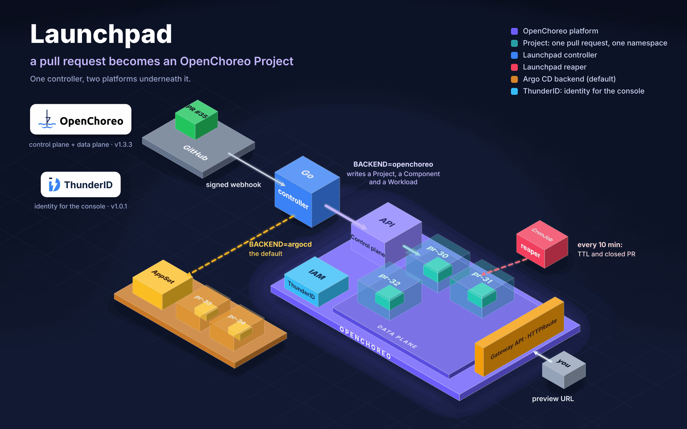

This is the Kubernetes equivalent of Vercel preview deployments and Heroku Review Apps. It
exists because reviewing a diff is guesswork; clicking the thing is not.

---

## Contents

- [Launchpad on OpenChoreo](#launchpad-on-openchoreo) — installing it, deploying on it, and
  the Project-per-PR backend
- [On AWS, driven by a real pull request](#on-aws-driven-by-a-real-pull-request)
- [What I learned from OpenChoreo](#what-i-learned-from-openchoreo)
- [The Argo CD backend](#the-argo-cd-backend) — the default, and what runs the TLS install
- [Components](#components) · [Isolation](#isolation-and-security) · [Monitoring](#monitoring)
- [Run it](#run-it-on-aws) · [Limits](#limits) · [Status](#status)

---

## The problem

A reviewer who wants to actually run a branch has to pull it, install dependencies, run
migrations, resolve a port conflict, and lose half an hour. Most don't. They read the diff,
write "LGTM", and merge.

Launchpad removes that cost, on a platform the team already runs.

---

## Launchpad on OpenChoreo

<a href="https://openchoreo.dev"></a>

[OpenChoreo](https://openchoreo.dev) is the open-source internal developer platform from
Choreo Labs (formerly WSO2), a CNCF Sandbox project. It models software as **Components**
inside **Projects**, promoted through fixed **Environments** on a registered data plane.

I installed it (v1.3.3, control plane and data plane), deployed this project's demo workload
on it, read how it turns two objects into a running service, and then taught Launchpad's
controller to use it as a deployment engine. All three steps are below, in that order.

### 1. Installing it

**OpenChoreo v1.3.3 on a local k3d cluster**, control plane and data plane, following the
official [Run Locally on K3d](https://openchoreo.dev/docs/getting-started/try-it-out/on-k3d-locally/)
guide step by step. The install is not one chart; it is a platform:

| Layer | What it is there for |
|---|---|
| Gateway API v1.5.1 | The CRDs behind every `HTTPRoute` OpenChoreo creates |
| cert-manager v1.19.4 | Certificates between the control plane and the data plane |
| External Secrets v2.0.1 + OpenBao | Where platform secrets live; a `ClusterSecretStore` joins them |
| kgateway v2.3.11 | The gateway data path |
| ThunderID v1.0.1 | Identity for the console |
| openchoreo-control-plane 1.3.3 | The API: Projects, Components, Workloads, Environments |
| openchoreo-data-plane 1.3.3 | Where workloads actually run, registered as a `ClusterDataPlane` |

Docker Desktop on WSL2 with 10 GB of memory; the console then lists the data plane as
**Connected**. Every command, and the version of every tool, is in
[`docs/openchoreo.md`](docs/openchoreo.md) — written so someone else can repeat it.

### 2. Deploying on it

The demo image went on with one `kubectl apply` of two objects, a `Component` and a
`Workload` ([`deploy/openchoreo/launchpad-demo.yaml`](deploy/openchoreo/launchpad-demo.yaml)).
OpenChoreo turned them into a running service:

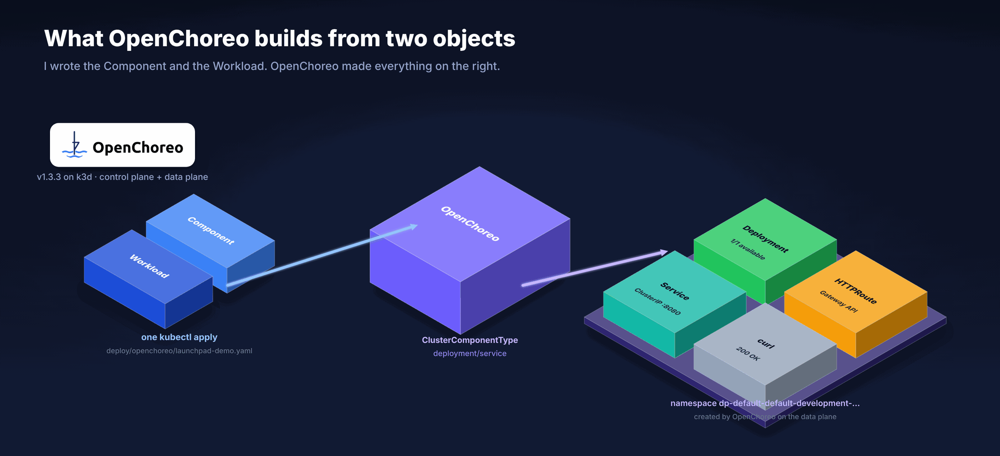

```text
NAME             PROJECT   COMPONENTTYPE        AGE
launchpad-demo   default   deployment/service   108s

NAMESPACE                                 NAME                                READY   UP-TO-DATE   AVAILABLE
dp-default-default-development-f8e58905   deployment.apps/launchpad-demo-...  1/1     1            1
dp-default-default-development-f8e58905   service/launchpad-demo              ClusterIP   8080/TCP
dp-default-default-development-f8e58905   httproute.../launchpad-demo-http-.. ["development-default.openchoreoapis.localhost"]
```

`curl` on that route returns `200 OK`. Reading what OpenChoreo had built — in particular
*which* namespace it chose, and from what — is what decided the design of the backend below.

### 3. Making Launchpad deploy through it

What OpenChoreo does not model, as it ships, is the short-lived environment: one per pull
request, created on open and destroyed on close. There is an open issue asking for exactly
that ([openchoreo#4345](https://github.com/openchoreo/openchoreo/issues/4345)). This backend
is one answer to it, built on OpenChoreo's own objects rather than around them.

With `BACKEND=openchoreo` the controller stops editing an ApplicationSet. For each pull
request it asks OpenChoreo for a **Project**, which owns its own namespace on the data plane:

| PR event | What the controller writes |
|---|---|
| opened / reopened | `Project pr-N`, `ProjectReleaseBinding pr-N-development`, `Component launchpad-demo-pr-N`, and a `Workload` running `launchpad-demo:<commit>` |
| synchronize (new push) | Patches the Workload's image to the new commit. Nothing else changes |
| closed | Deletes the `Project`, and with it the preview's namespace |

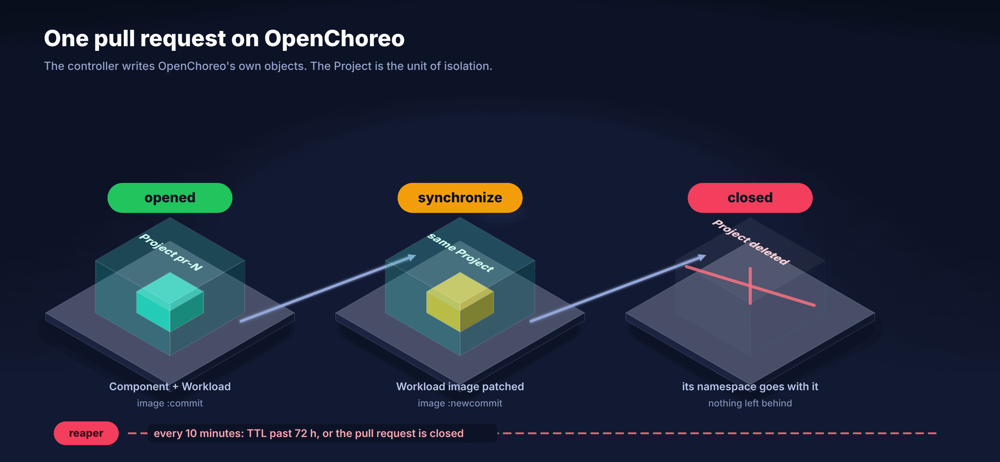

The preview, served through OpenChoreo's gateway:

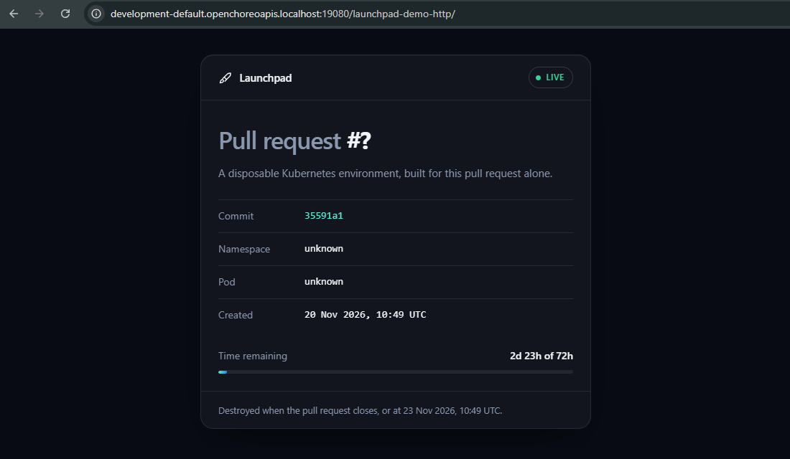


*The page says "PR #?" and "unknown" because it reads the PR number and namespace from
environment variables that Launchpad's own chart sets and this Workload does not. The
"destroyed when the pull request closes" footer is the demo's own text.*

### Why a Project, and not a Component

The namespace OpenChoreo creates is named after the namespace, project and environment
(`dp-default-default-development-…`), so several Components in one Project **share** a
namespace. Per-pull-request isolation therefore has to happen one level up: a Project per
pull request. Deleting the Project takes the namespace with it, which is also what makes
teardown a single delete instead of a sweep.

### Permissions

The controller's permissions in this mode are a namespaced `Role`: `get`, `create`, `patch`
and `delete` on `projects`, `projectreleasebindings`, `components` and `workloads`. No
`list`, no `watch`, nothing cluster-wide, no access to secrets. The reaper needs `list` and
`delete` on `projects` and nothing else.

| Variable | Default | Meaning |
|---|---|---|
| `BACKEND` | `argocd` | `argocd` or `openchoreo` |
| `OC_NAMESPACE` | `default` | OpenChoreo namespace holding the objects |
| `OC_ENVIRONMENT` | `development` | Environment each preview is bound to |
| `OC_IMAGE` | `sihanudayaratna/launchpad-demo` | Image repository; the commit SHA is the tag |
| `OC_HOST` | `development-default.openchoreoapis.localhost:19080` | Gateway host and port |

### Reclamation

The TTL reaper has an `openchoreo` mode as well. Instead of walking preview namespaces it
lists the `pr-N` Projects and deletes the ones past their TTL or whose pull request has
closed — which is what catches a preview whose close webhook never arrived. It only ever
touches names matching `pr-<number>`, so OpenChoreo's own Projects are left alone, and
`DRY_RUN` still defaults to on.

### What the end-to-end test proves

[`scripts/openchoreo-e2e.sh`](scripts/openchoreo-e2e.sh) builds the controller, runs it
against a local OpenChoreo cluster, and sends it signed pull-request webhooks the way GitHub
would. All thirteen checks pass:

```
== webhook security
  PASS: unsigned webhook rejected (401)
== PR #9001 opened
  PASS: opened accepted (202)
  PASS: Project pr-9001 created
  PASS: Workload runs the PR's commit
== waiting up to 180s for the preview URL
  PASS: http://development-default.openchoreoapis.localhost:19080/launchpad-demo-pr-9001-http/ answers 200
== replay
  PASS: replayed webhook accepted (202)
  PASS: replay changed nothing
== PR #9001 closed
  PASS: closed accepted (202)
  PASS: Project pr-9001 deleted
  PASS: data-plane namespace cleaned up
  PASS: closing again is harmless (202)
```

So the whole lifecycle holds up: a pull request becomes an isolated OpenChoreo Project that
serves HTTP, a second identical webhook changes nothing, and closing the pull request removes
the Project and the namespace underneath it.

### Limits of this backend

- The Kyverno policies, `ResourceQuota` and `NetworkPolicy` come from Launchpad's own chart
  and are **not** applied in this mode. Isolation here is OpenChoreo's: one namespace per
  Project
- The PR comment carries the gateway URL. That body is unit-tested, but the end-to-end test
  runs without a GitHub token, so I have not watched a real comment appear in this mode
- The reaper's OpenChoreo mode is unit-tested; I have not yet run it on a schedule against a
  live cluster
- The Component is the demo app. Other workloads mean parameterising the builders in
  `cmd/controller/openchoreo.go`
- I did not test promotion between environments, or the build and observability planes (both
  optional, neither installed). I make no claim about them

OpenChoreo is an Apache-2.0 project of Choreo Labs; its name and logo are used here only to
identify the platform this backend runs on. This repository is not affiliated with or
endorsed by it.

---

## On AWS, driven by a real pull request

The same backend runs on the Terraform stack. `bootstrap = "openchoreo"` brings the node up
with OpenChoreo in Argo CD's place: k3s **without Traefik**, so OpenChoreo's gateway owns 80
and 443 and preview URLs carry no port; a swap file, because the control plane is tight on a
free-tier node's 8 GiB; and the controller published on a **NodePort**, because there is no
Ingress left to put it behind.

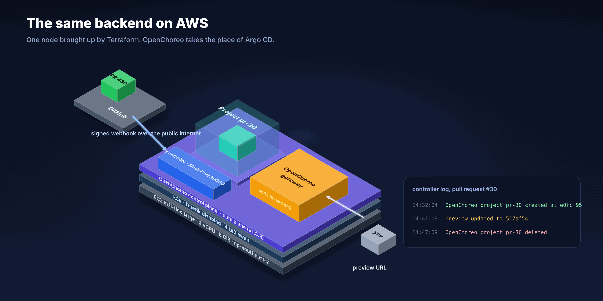

GitHub posts to that NodePort. A pull request on this repository — opened, pushed to, then
merged — drove the whole loop on the EC2 node:

```
14:32:04  PR #30: OpenChoreo project pr-30 created at e0fcf95
14:41:03  PR #30: preview updated to 517af54
14:47:09  PR #30: OpenChoreo project pr-30 deleted
```

Between the first line and the last, the Project held a data-plane namespace of its own, a
running pod and an `HTTPRoute`, and the preview answered `200` on the public gateway. The
middle line is a second commit rolling the same preview forward rather than building another
one. Merging took the Project and its namespace with it.

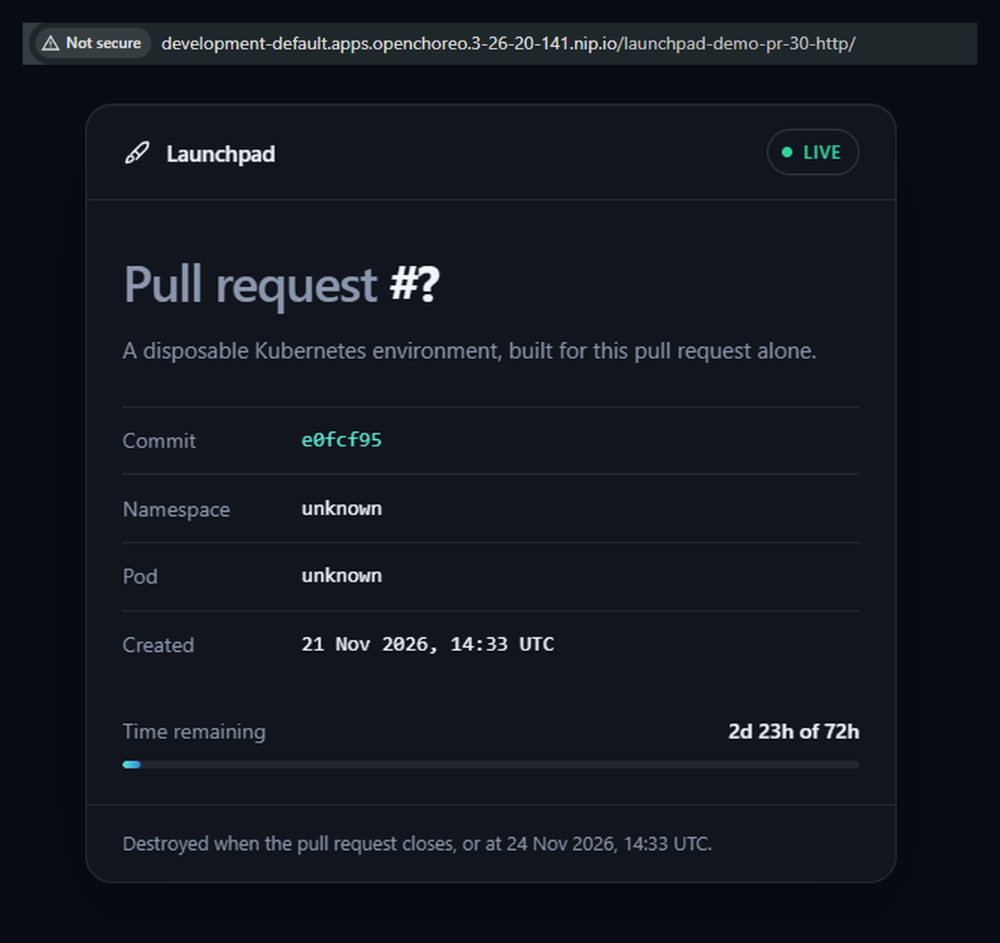

*The preview for a pull request on this repository, reached over the public internet through
OpenChoreo's gateway on the EC2 node. The commit is the one the pull request is on.*

---

## What I learned from OpenChoreo

- **Different units.** Launchpad's unit is a short-lived environment per pull request.
  OpenChoreo's is a long-lived Component moved through a fixed set of Environments. They
  answer different questions, which is what made this backend worth writing
- **Isolation follows the Project, not the Component** — the reason a pull request maps to a
  Project, described above
- **OpenChoreo gives far more out of the box**: a console, a catalog, ownership, a project
  model, and an install that wires up a gateway, certificates and a secret store. Launchpad
  is smaller and more explicit about every moving part

How the two models compare:

| | Launchpad | OpenChoreo |
|---|---|---|
| What describes a deployment | One ApplicationSet element (`prNumber`, image tag) | A `Component` and a `Workload` |
| Template that renders it | `charts/preview` (Deployment, Service, Ingress, quota, NetworkPolicy) | `ClusterComponentType` `deployment/service` |
| Unit of environment | One namespace per pull request, `preview-pr-N` | Fixed `Environment`s with a `DeploymentPipeline` |
| Where workloads run | The same cluster | A data plane registered with the control plane |
| Routing | Traefik Ingress, `pr-N.<name>.duckdns.org` | Gateway API `HTTPRoute` |
| Lifecycle | Created on PR open, destroyed on close, TTL reaper | A long-lived Component promoted through environments |

---

## The Argo CD backend

The default, and the install that carries TLS. Two loops meet at one ApplicationSet: the
delivery loop moves code into the cluster; the lifecycle loop decides which environments
still deserve to exist.

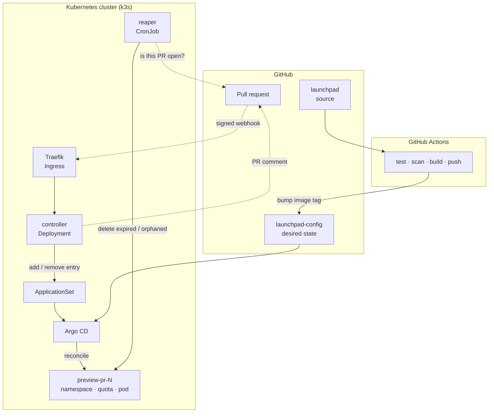

Nothing here runs `kubectl apply`. The controller writes to the ApplicationSet; Argo CD
reconciles the cluster against it. The controller itself is deployed the same way, so it is
managed by the system it drives.

The bot comment on a pull request:

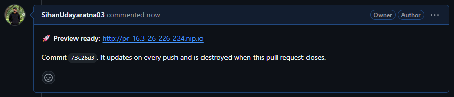

On AWS with TLS switched on, the preview is served over https from `pr-N.<name>.duckdns.org`
with a certificate from Let's Encrypt (this is pull request #33, the one that added the
DuckDNS name):

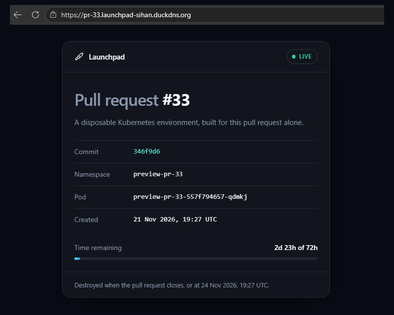

The Grafana dashboard fed by the controller's metrics:


---

## Components

### `cmd/controller` — webhook receiver

Long-running Deployment, reached through a Traefik Ingress at `/webhook` (a NodePort on the
OpenChoreo install). Verifies the GitHub HMAC-SHA256 signature on every request, then writes
the backend's objects, and posts (or edits) one comment on the pull request with the preview
URL.

- Signature comparison is constant-time (`hmac.Equal`), so timing does not leak it
- Request bodies are capped at 1 MiB
- Adding a preview is idempotent — GitHub replays webhooks
- ApplicationSet read-modify-write is serialised with a mutex, so two webhooks arriving
  together cannot overwrite each other
- The comment carries a hidden marker, so the bot edits its own comment instead of spamming
  a new one
- A failed comment never fails the webhook; it only increments a metric
- Preview host is `pr-N.<ip-with-dashes>.nip.io`, or `pr-N.<name>.duckdns.org` with a
  DuckDNS name, or the OpenChoreo gateway host on that backend
- `TLS_RESOLVER` names a Traefik certificate resolver. When it is set, the comment links to
  https and each ApplicationSet element carries the resolver, so existing previews move over
  without a new push; empty, the default, changes nothing
- One binary, two backends: `BACKEND` selects Argo CD (the default) or OpenChoreo

### `cmd/reaper` — environment reclamation

CronJob, every 10 minutes. For each preview it asks whether the environment should still
exist, and destroys it when any of these hold:

| Condition | Why it matters |
|---|---|
| No ApplicationSet entry | Argo CD does not remove namespaces it created via `CreateNamespace=true`, so they outlive their Application. Confirmed on AWS |
| Older than TTL (default 72h) | Someone opens a PR and goes on leave |
| Pull request is closed | The obvious case, and the one that is easiest to miss |

The binary defaults to `DRY_RUN=true`. A job that deletes namespaces should not delete
anything the first time it runs somewhere new; the Helm chart turns it off explicitly. A
GitHub API failure is never treated as evidence that a PR is closed. On the OpenChoreo
backend it sweeps `pr-N` Projects instead; the orphan rule has nothing to say there, because
the Project *is* the record of the preview.

### `launchpad-config` — the GitOps repository

Helm charts, ApplicationSet definitions, monitoring, Kyverno policies, per-environment
values. The single source of truth for cluster state.
[SihanUdayaratna03/launchpad-config](https://github.com/SihanUdayaratna03/launchpad-config)

---

## Delivery pipeline

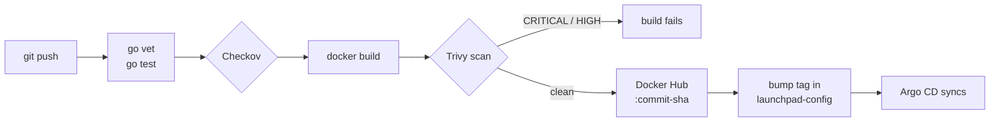

The only manual step is the first `git push`.

---

## Isolation and security

Every preview on the Argo CD backend is a separate namespace with the same guard rails,
applied automatically:

| Layer | What it does |
|---|---|
| `ResourceQuota` | Caps pods, CPU and memory per preview, so one PR cannot starve the node |
| `NetworkPolicy` | Default-deny between namespaces |
| Kyverno | Admission policies on preview namespaces: allowed registries only, no `:latest`, no privileged containers, non-root only, requests and limits required |
| RBAC | Controller and reaper have separate ServiceAccounts with only the verbs they need, on either backend |
| Webhook | HMAC-SHA256, constant-time compare, 1 MiB body limit |
| Supply chain | Trivy scans the image and Checkov scans the infrastructure code; both run in CI |
| Host | IMDSv2 required, encrypted gp3 volume, SSH and the Kubernetes API open only to one CIDR |

On the OpenChoreo backend the first three rows are OpenChoreo's to provide; what Launchpad
guarantees there is one Project, and therefore one namespace, per pull request.

---

## Monitoring

Prometheus and Grafana run in a `monitoring` namespace, deployed by Argo CD like everything
else. The controller exposes `/metrics` (not published through the Ingress):

| Metric | Meaning |
|---|---|
| `launchpad_webhook_requests_total{result}` | Webhooks by outcome (the `result` label) |
| `launchpad_preview_events_total{action}` | Previews created and destroyed |
| `launchpad_comment_failures_total` | Failed PR comments |
| `launchpad_webhook_duration_seconds` | Time spent handling a webhook |

Six alert rules ship with it: controller down, webhook errors, webhook rejections, comment
failures, too many previews (more than 8) and a preview that is not ready. A provisioned
Grafana dashboard shows the same data.

Alertmanager takes it from there. It groups alerts by name and severity, waits 30 seconds for
others to join the group, repeats a still-firing alert every four hours rather than every
evaluation, and sends the result to a Discord channel. A `critical` alert goes out in 10
seconds and repeats hourly, and it silences the `warning` of the same name, since a
controller that is down also makes its previews look unhealthy.

The webhook URL is a credential, so it is not in the GitOps repository: Alertmanager reads it
from a mounted Secret through `webhook_url_file`, which also keeps it out of the config
Alertmanager serves on its own API.

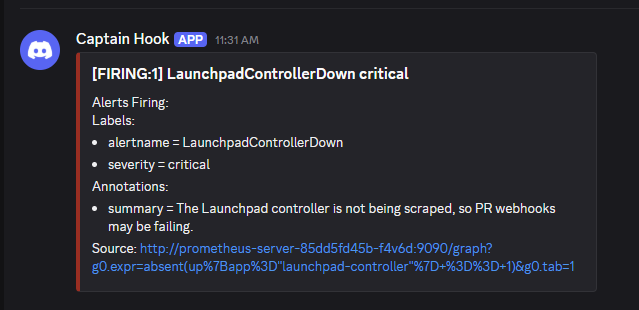

[`hack/local-alertmanager-test.sh`](https://github.com/SihanUdayaratna03/launchpad-config/blob/main/hack/local-alertmanager-test.sh)
in `launchpad-config` follows one alert the whole way on a throwaway k3d cluster: a rule
fires, Prometheus hands it to Alertmanager, and Alertmanager delivers it to Discord. It
checks the message really arrived by reading Alertmanager's own
`alertmanager_notifications_total{integration="discord"}` and the failure counter beside it.

Open Grafana:

```bash
kubectl -n monitoring port-forward svc/grafana 3000:80
kubectl -n monitoring get secret grafana -o jsonpath='{.data.admin-password}' | base64 -d
```

Then browse to `http://localhost:3000` and sign in as `admin`.

---

## Measured on AWS

One `c7i-flex.large` (2 vCPU, 4 GiB) in `ap-southeast-2`, Free Tier eligible, on the Argo CD
install:

| Measurement | Result |
|---|---|
| `terraform apply` to "bootstrap complete" | about 4 minutes |
| Webhook handling time | about 1.6 – 1.8 s |
| Node memory, platform only | 63% |
| Node memory, with monitoring | about 81% |
| Node memory, with monitoring and one preview | about 84% |
| Memory of one preview pod | about 2.5 MiB |

The OpenChoreo install needs the 8 GiB node and a swap file; its control plane is the heavy
part, not the previews.

---

## Run it on AWS

Requires Terraform, an AWS account and the AWS CLI configured.

```bash
cd terraform
# create terraform.tfvars and set my_ip_cidr to your public IP, e.g. "203.0.113.7/32"
terraform init
terraform apply
```

The user-data script installs k3s and Argo CD and registers the root application, so the rest
of the platform comes up on its own. Setting `bootstrap = "openchoreo"` brings the node up
with OpenChoreo in its place instead; everything else about the stack is the same, and
`terraform output openchoreo` then prints the gateway domain and the webhook endpoint to hand
GitHub. Then:

1. Fetch the kubeconfig and point it at the new public IP.
2. Create the two secrets in the `argocd` namespace:

   ```bash
   kubectl -n argocd create secret generic launchpad-webhook --from-literal=secret="<random hex>"
   kubectl -n argocd create secret generic launchpad-github  --from-literal=token="<fine-grained PAT>"
   ```

3. In the GitHub repository, add a webhook with Payload URL `http://<public_ip>/webhook`
   (`https://webhook.<name>.duckdns.org/webhook` with TLS, see below) — on the OpenChoreo
   install it is `http://<public_ip>:30080/webhook`, since the gateway holds port 80 there —
   with content type `application/json`, the same secret, and the **Pull requests** event.
4. Open a pull request.

`terraform destroy` removes everything; nothing keeps billing.

### TLS and a stable name

Make a subdomain at [duckdns.org](https://www.duckdns.org), then:

```hcl
# terraform.tfvars
acme_email   = "you@example.com"
duckdns_name = "launchpad-yourname"
acme_staging = true                    # false for a real certificate
```

```bash
export TF_VAR_duckdns_token=...        # used by a local curl only
terraform apply
```

Terraform points `<name>.duckdns.org` at the Elastic IP (DuckDNS answers for every name below
it), so `pr-N.<name>.duckdns.org` and `webhook.<name>.duckdns.org` resolve. The node's Traefik
obtains a certificate for each, http redirects to https, and the controller links `https://`
URLs. The token never reaches the instance, its user data or the Terraform state.

Start with `acme_staging = true`: the staging CA has far higher limits, so a mistake does not
spend the real ones, but GitHub and browsers do not trust its certificates, so turn SSL
verification off on the webhook for that run. Changing `acme_staging` replaces the node,
because the setting lives in its user data.

---

## Local setup

Requires Docker, kind, kubectl and Helm. For the OpenChoreo backend, follow
[`docs/openchoreo.md`](docs/openchoreo.md) instead and run
[`scripts/openchoreo-e2e.sh`](scripts/openchoreo-e2e.sh).

```bash
kind create cluster --name launchpad

kubectl create namespace argocd
kubectl apply -n argocd -f \
  https://raw.githubusercontent.com/argoproj/argo-cd/stable/manifests/install.yaml
kubectl -n argocd rollout status deploy/argocd-server

kubectl create secret generic launchpad-webhook \
  -n argocd --from-literal=secret="<your webhook secret>"

kubectl -n argocd port-forward svc/argocd-server 8080:443
```

Point an Argo CD Application at `launchpad-config/charts/controller` and the rest comes up on
its own.

Sending a webhook by hand:

```bash
BODY='{"action":"opened","number":3,"pull_request":{"head":{"sha":"abc"}}}'
SIG=$(echo -n "$BODY" | openssl dgst -sha256 -hmac "<secret>" | awk '{print $2}')

curl -X POST localhost:8090/webhook \
  -H 'Content-Type: application/json' \
  -H "X-Hub-Signature-256: sha256=$SIG" \
  -d "$BODY"
```

Without the signature header the same request returns `401 Unauthorized`.

---

## Design decisions

**Two repositories.**
Application source lives here; deployment state lives in `launchpad-config`. A code commit is
not a deployment. Keeping them apart means cluster history stays readable, and CI never holds
cluster credentials — Argo CD pulls, CI does not push.

**Immutable image tags.**
Workloads are pinned to a commit SHA, never `:latest`. A pod that restarts three weeks later
runs exactly the code that was deployed.

**Cleanup is a feature, not an afterthought.**
Creating environments is the easy half. Every environment carries a TTL, a `ResourceQuota`,
and an automatic reaper.

**Least privilege, split two ways.**
The controller can `get` and `patch` ApplicationSets — nothing else. The reaper has a separate
ServiceAccount that can `list` and `delete` namespaces but cannot add entries. Neither can
read secrets:

```console
$ kubectl auth can-i get secrets \
    --as=system:serviceaccount:argocd:launchpad-controller -n argocd
no

$ kubectl auth can-i patch applicationsets \
    --as=system:serviceaccount:argocd:launchpad-controller -n argocd
yes
```

**One image, two binaries.**
A multi-stage build produces `/controller` and `/reaper` into a distroless, non-root base. Two
images would mean two builds, two scans and two tags for one codebase.

---

## Things that broke, and what they taught

**The quota holds.** Scaling a preview Deployment to 50 replicas stops at 10:

```console
$ kubectl scale deployment preview-pr-42 --replicas=50 -n preview-pr-42
$ kubectl describe resourcequota preview-quota -n preview-pr-42
Resource         Used    Hard
pods             10      10
limits.cpu       2       2

Error creating: pods "preview-pr-42-..." is forbidden:
exceeded quota: preview-quota, requested: pods=1, used: pods=10, limited: pods=10
```

**Trivy caught two HIGH CVEs on the first pipeline run** — `golang.org/x/net` and
`golang.org/x/text`, both reached through `client-go`, neither written by me. The build
stopped until they were patched. `go mod tidy` then pulled one of them back down to the
vulnerable version, which needed an explicit bump to hold.

**A 404 from GitHub means two different things.** The reaper read 404 as "this PR no longer
exists" and destroyed an environment whose pull request was open — the repository was private
and the call was unauthenticated. 404 is also what GitHub returns for "you may not look at
this". Dry-run mode exists for exactly this class of mistake.

**Argo CD leaves the namespace behind.** After a PR closed, the Application disappeared but
`preview-pr-N` stayed, empty. With `CreateNamespace=true` Argo creates the namespace but does
not own it. This was found on AWS, not in theory, and it is why the reaper has an "orphaned"
rule instead of only a TTL. The OpenChoreo backend does not have this problem: the namespace
belongs to the Project.

**The first image does not exist yet.** A new PR creates the environment in seconds, but CI
needs longer to push `:sha`. The pod sits in `ErrImagePull` and the URL says "no available
server" until the image lands. Kubernetes retries, so it heals itself; I documented it rather
than hiding it.

**Certificates are requested when Traefik starts.** Restart it before they are issued and
validation can fail, because a rolling restart briefly has two pods and the challenge can
reach the old one. Recreating the Ingress asks again; issued certificates are kept on the node
and survive restarts.

**Prometheus 3 rejects a target with no `Content-Type`.** My local test used a minimal
stand-in server that sent none, so the target stayed down. Reproducing it locally on k3d
first, before spending AWS time, is how it was caught.

---

## Limits

Honest list of what this is not:

- **TLS is for the Argo CD backend.** Traefik obtains a certificate per preview over HTTP-01;
  the OpenChoreo install on AWS is still plain http through its gateway
- **Real certificates need a domain with a limit of its own.** `nip.io` and `sslip.io` are not
  on the Public Suffix List, so every certificate under them shares one Let's Encrypt limit
  with the rest of the world. Use a DuckDNS name; a production certificate under an IP-derived
  name is refused
- **The Elastic IP lives and dies with the stack.** It bills like any public IPv4 address while
  it is up and is released by `terraform destroy`. With a DuckDNS name the hostnames and the
  webhook URL survive that; only `my_ip_cidr` needs updating if your own address changed
- **A closed PR's empty namespace can stay up to 10 minutes** on the Argo CD backend, until the
  reaper runs
- **First-image race.** A new commit's pod can show `ErrImagePull` until CI has pushed the
  `:sha` image; it recovers by itself on the next retry
- **Secrets are created by hand** per cluster (`launchpad-webhook`, `launchpad-github`)
- **One node.** At about 84% memory it fits a handful of previews, not a team
- The OpenChoreo backend's own limits are listed
  [above](#limits-of-this-backend)

---

## Stack

| Layer | Tool |
|---|---|
| Platform | OpenChoreo v1.3.3 (Projects, Components, Workloads, Gateway API) |
| GitOps | Argo CD + ApplicationSet (the default backend) |
| Orchestration | Kubernetes (kind and k3d locally, k3s on EC2) |
| Ingress | Traefik, Gateway API on OpenChoreo |
| Packaging | Helm |
| Policy | Kyverno, NetworkPolicy, ResourceQuota |
| Containers | Docker, multi-stage, distroless, non-root |
| Registry | Docker Hub |
| CI | GitHub Actions, Trivy, Checkov |
| Infrastructure | Terraform |
| Observability | Prometheus, Alertmanager, Grafana |
| Language | Go |
| AWS | EC2 + VPC |

---

## Repository layout

    cmd/
      controller/        webhook receiver, preview lifecycle on either backend,
                         PR comment, metrics
      reaper/            TTL, orphan and closed-PR reclamation, on either backend
    demo/                the trivial workload deployed into each preview
    terraform/           VPC, security groups, EC2, k3s + Argo CD or OpenChoreo bootstrap
    deploy/              bootstrap manifests, and the OpenChoreo Component and Workload
    scripts/             end-to-end check of the OpenChoreo backend
    docs/                diagrams, screenshots, the OpenChoreo install runbook
    .github/workflows/   test, scan, build, push, bump
    Dockerfile           multi-stage, both binaries

---

## Status

| Stage | |
|---|---|
| Local cluster, Argo CD, GitOps sync loop | Done |
| Helm chart with per-environment values | Done |
| ApplicationSet generator, ResourceQuota | Done |
| Controller: webhook, lifecycle, in-cluster RBAC | Done |
| Webhook HMAC signature verification | Done |
| PR comment bot (create, edit, preview URL) | Done |
| CI: test, Trivy, Checkov, build, push, tag bump | Done |
| Reaper: TTL, orphan and closed-PR cleanup | Done |
| NetworkPolicy, Kyverno policies | Done |
| Terraform + k3s on EC2, verified end to end | Done |
| Prometheus, Grafana, alert rules | Done |
| OpenChoreo installed, control plane and data plane | Done |
| OpenChoreo backend: a Project per pull request, verified end to end | Done |
| Reaper sweeps OpenChoreo Projects | Done |
| OpenChoreo backend on AWS, driven by a real pull request | Done |
| Alertmanager, alerts delivered to a Discord channel | Done |
| Elastic IP and TLS (Let's Encrypt), on AWS with a real pull request | Done |

---

## What this project is about

The workload deployed into a preview environment is deliberately trivial. It is a prop. The
work is everything around it: the reconciliation loop, the isolation boundaries, the quota
enforcement, the signature check, the teardown guarantees, the infrastructure as code, the
monitoring, and a pipeline that moves a commit from a laptop into a cluster without anyone
running a command.
