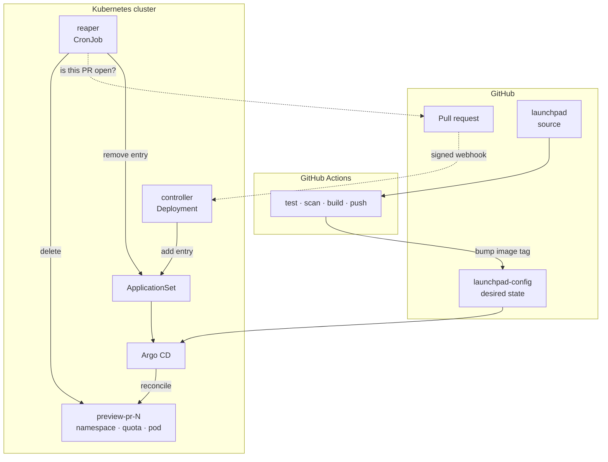
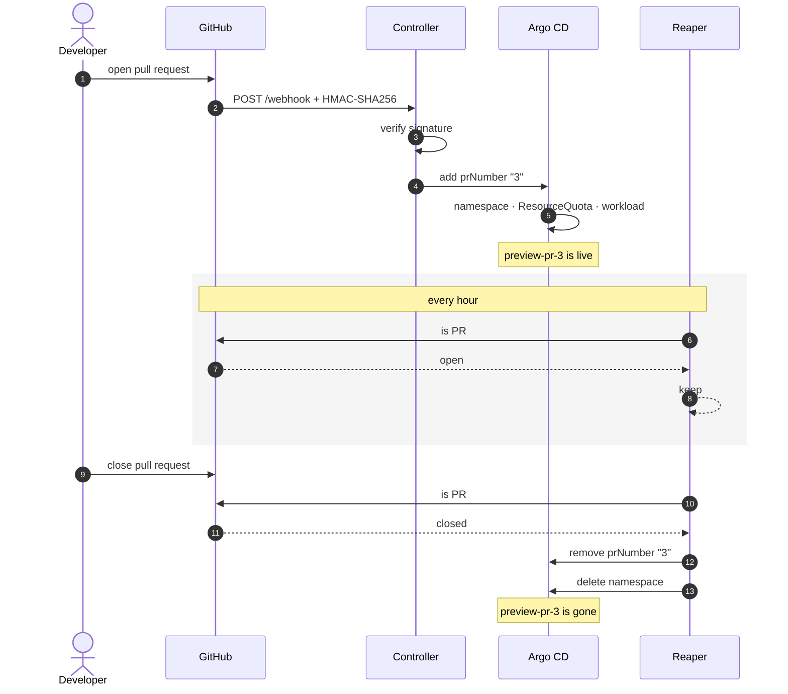
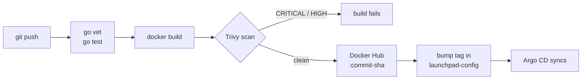

# Launchpad

**Every pull request gets its own live environment.**

Open a PR and a preview environment appears on Kubernetes: its own namespace, its
own quota, its own pod. Close the PR and everything it created goes away.

This is the Kubernetes equivalent of Vercel preview deployments and Heroku Review
Apps. It exists because reviewing a diff is guesswork; clicking the thing is not.

---

## The problem

A reviewer who wants to actually run a branch has to pull it, install dependencies,
run migrations, resolve a port conflict, and lose half an hour. Most don't. They read
the diff, write "LGTM", and merge.

Launchpad removes that cost.

---

## Architecture

Two loops meet at one ApplicationSet. The delivery loop moves code into the cluster;
the lifecycle loop decides which environments still deserve to exist.



Nothing here runs `kubectl apply`. The controller writes to the ApplicationSet;
Argo CD reconciles the cluster against it. The controller itself is deployed the
same way — it is managed by the system it drives.

---

## Lifecycle of one pull request



---

## Delivery pipeline



The only manual step is the first `git push`.

---

## Components

### `cmd/controller` — webhook receiver

Long-running Deployment. Verifies the GitHub HMAC-SHA256 signature on every request,
then adds or removes a PR entry in the Argo CD ApplicationSet through `client-go`.

- Signature comparison is constant-time (`hmac.Equal`), so timing does not leak it
- Request bodies are capped at 1 MiB
- Adding a preview is idempotent — GitHub replays webhooks

### `cmd/reaper` — environment reclamation

Hourly CronJob. For each `preview-pr-N` namespace it asks whether the environment
should still exist, and destroys it when any of these hold:

| Condition | Why it matters |
|---|---|
| No ApplicationSet entry | Argo CD does not own namespaces it creates via `CreateNamespace=true`, so they outlive their Application |
| Older than TTL (default 72h) | Someone opens a PR and goes on leave |
| Pull request is closed | The obvious case, and the one that is easiest to miss |

Defaults to `DRY_RUN=true`. A job that deletes namespaces should not delete anything
the first time it runs somewhere new. A GitHub API failure is never treated as
evidence that a PR is closed.

### `launchpad-config` — the GitOps repository

Helm charts, ApplicationSet definitions, per-environment values. The single source
of truth for cluster state.
[SihanUdayaratna03/launchpad-config](https://github.com/SihanUdayaratna03/launchpad-config)

---

## Design decisions

**Two repositories.**
Application source lives here; deployment state lives in `launchpad-config`. A code
commit is not a deployment. Keeping them apart means cluster history stays readable,
and CI never holds cluster credentials — Argo CD pulls, CI does not push.

**Immutable image tags.**
Workloads are pinned to a commit SHA, never `:latest`. A pod that restarts three
weeks later runs exactly the code that was deployed.

**Cleanup is a feature, not an afterthought.**
Creating environments is the easy half. Every environment carries a TTL, a
`ResourceQuota`, and an automatic reaper.

**Least privilege, split two ways.**
The controller can `get` and `patch` ApplicationSets — nothing else. The reaper has
a separate ServiceAccount that can `list` and `delete` namespaces but cannot add
entries. Neither can read secrets:

```console
$ kubectl auth can-i get secrets \
    --as=system:serviceaccount:argocd:launchpad-controller -n argocd
no

$ kubectl auth can-i patch applicationsets \
    --as=system:serviceaccount:argocd:launchpad-controller -n argocd
yes
```

**One image, two binaries.**
A multi-stage build produces `/controller` and `/reaper` into a distroless,
non-root base. Two images would mean two builds, two scans and two tags for one
codebase.

---

## Things that broke, and what they taught

**The quota holds.** Scaling a preview Deployment to 50 replicas stops at 10:

```console
$ kubectl scale deployment preview-pr-42 --replicas=50 -n preview-pr-42
$ kubectl describe resourcequota preview-quota -n preview-pr-42
Resource         Used    Hard
pods             10      10
limits.cpu       2       2

Error creating: pods "preview-pr-42-..." is forbidden:
exceeded quota: preview-quota, requested: pods=1, used: pods=10, limited: pods=10
```

**Trivy caught two HIGH CVEs on the first pipeline run** — `golang.org/x/net` and
`golang.org/x/text`, both reached through `client-go`, neither written by me. The
build stopped until they were patched. `go mod tidy` then pulled one of them back
down to the vulnerable version, which needed an explicit bump to hold.

**A 404 from GitHub means two different things.** The reaper read 404 as "this PR no
longer exists" and destroyed an environment whose pull request was open — the
repository was private and the call was unauthenticated. 404 is also what GitHub
returns for "you may not look at this". Dry-run mode exists for exactly this class
of mistake.

---

## Stack

| Layer | Tool |
|---|---|
| Orchestration | Kubernetes (kind locally, k3s on EC2) |
| GitOps | Argo CD + ApplicationSet |
| Packaging | Helm |
| Containers | Docker, multi-stage, distroless, non-root |
| Registry | Docker Hub |
| CI | GitHub Actions + Trivy |
| Infrastructure | Terraform |
| Observability | Prometheus + Grafana |
| Language | Go |

---

## Repository layout

    cmd/
      controller/        webhook receiver, ApplicationSet lifecycle
      reaper/            TTL, orphan and closed-PR reclamation
    deploy/              bootstrap manifests
    .github/workflows/   test, scan, build, push, bump
    Dockerfile           multi-stage, both binaries

---

## Local setup

Requires Docker, kind, kubectl and Helm.

```bash
kind create cluster --name launchpad

kubectl create namespace argocd
kubectl apply -n argocd -f \
  https://raw.githubusercontent.com/argoproj/argo-cd/stable/manifests/install.yaml
kubectl -n argocd rollout status deploy/argocd-server

kubectl create secret generic launchpad-webhook \
  -n argocd --from-literal=secret="<your webhook secret>"

kubectl -n argocd port-forward svc/argocd-server 8080:443
```

Point an Argo CD Application at `launchpad-config/charts/controller` and the rest
comes up on its own.

Sending a webhook by hand:

```bash
BODY='{"action":"opened","number":3,"pull_request":{"head":{"sha":"abc"}}}'
SIG=$(echo -n "$BODY" | openssl dgst -sha256 -hmac "<secret>" | awk '{print $2}')

curl -X POST localhost:8090/webhook \
  -H 'Content-Type: application/json' \
  -H "X-Hub-Signature-256: sha256=$SIG" \
  -d "$BODY"
```

Without the signature header the same request returns `401 Unauthorized`.

---

## Status

| Stage | |
|---|---|
| Local cluster, Argo CD, GitOps sync loop | Done |
| Helm chart with per-environment values | Done |
| ApplicationSet generator, ResourceQuota | Done |
| Controller: webhook, lifecycle, in-cluster RBAC | Done |
| Webhook HMAC signature verification | Done |
| CI: test, Trivy scan, build, push, tag bump | Done |
| Reaper: TTL, orphan and closed-PR cleanup | Done |
| PR comment bot | Next |
| Terraform + k3s on EC2 | Planned |
| Prometheus, Grafana, alerting | Planned |

---

## What this project is about

The workload deployed into a preview environment is deliberately trivial. It is a
prop. The work is everything around it: the reconciliation loop, the isolation
boundaries, the quota enforcement, the signature check, the teardown guarantees,
and a pipeline that moves a commit from a laptop into a cluster without anyone
running a command.

Building things is easy. Making sure they go away is engineering.
